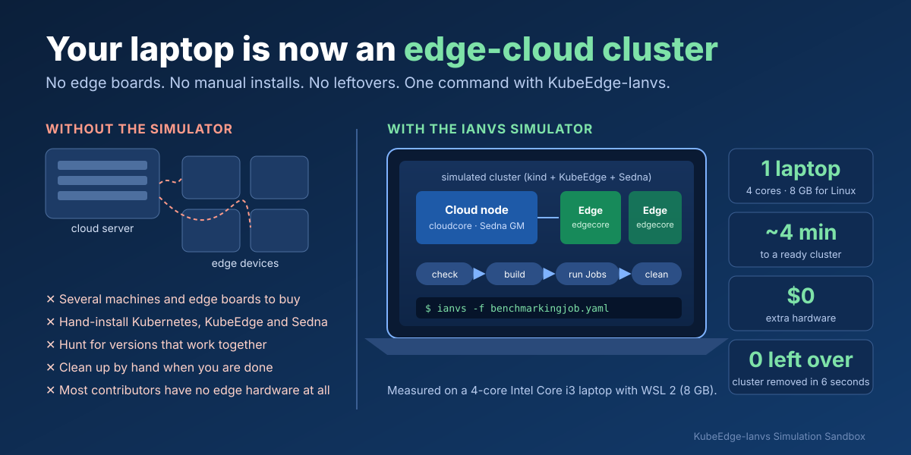
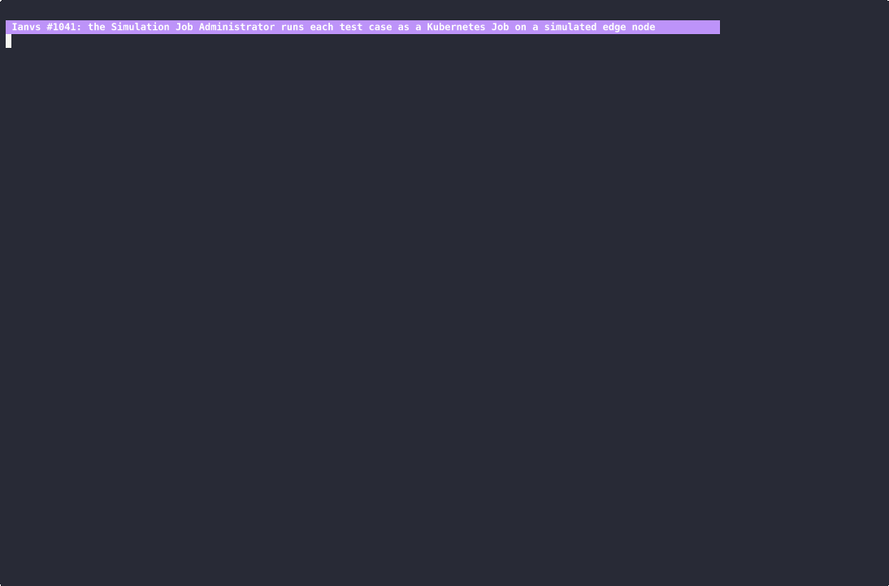
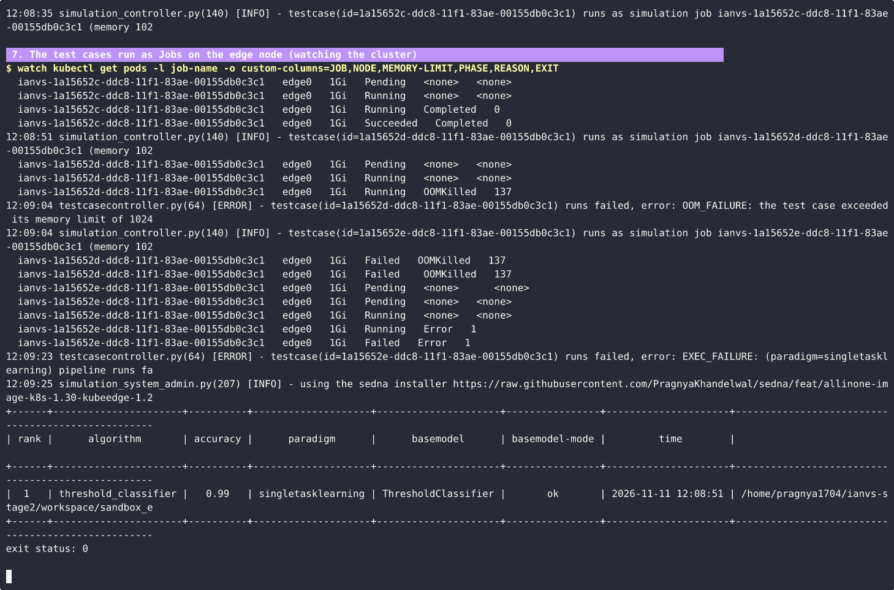
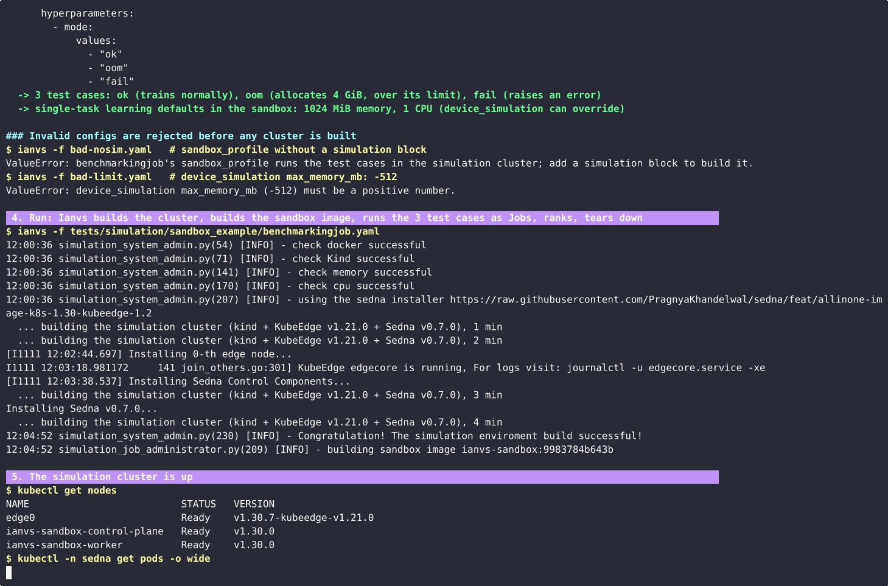
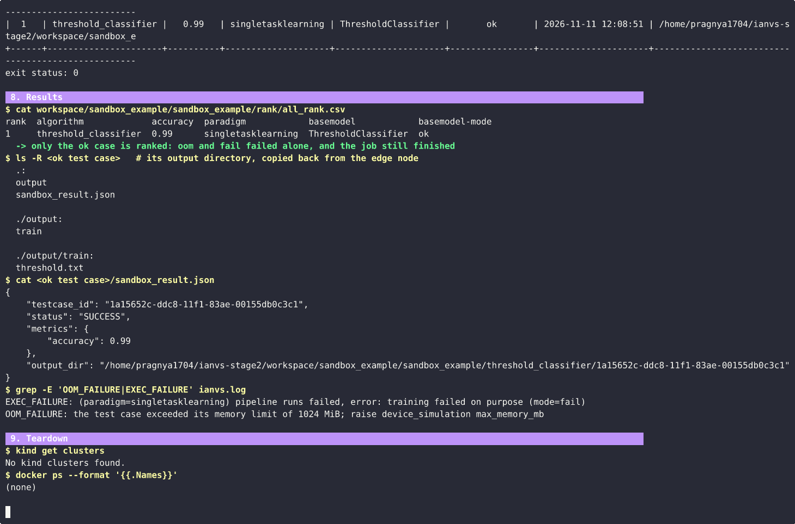
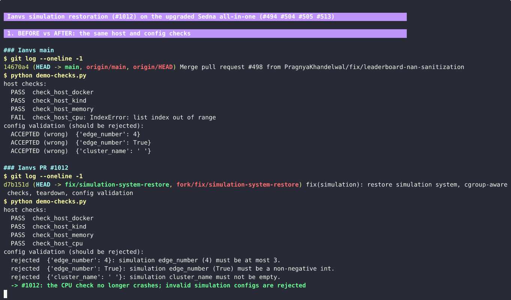
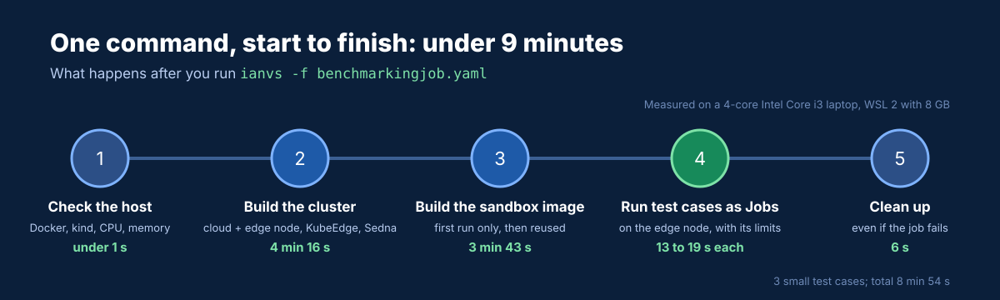
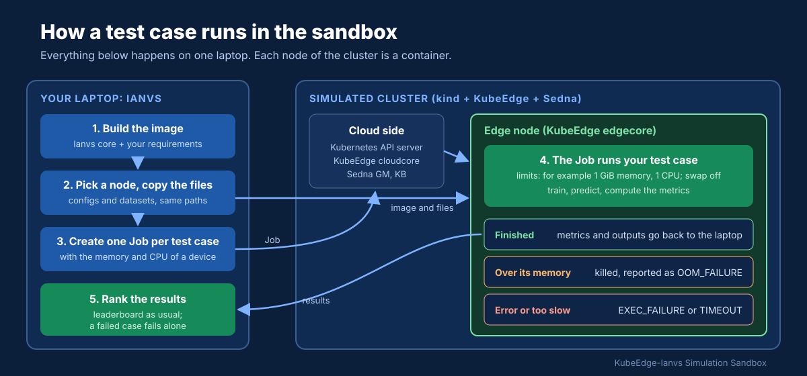
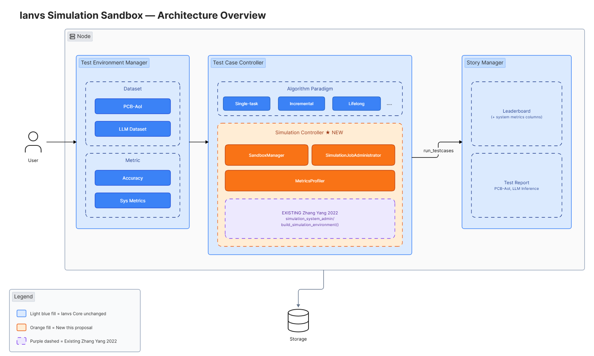

Picture this. Your model just scored **0.99 accuracy** on your laptop, and your mentor asks the obvious next question: *"Great, but will it run on an edge device with 1 GB of memory?"* You don't have a cloud server and a shelf of edge boards. You also don't have a free week to install Kubernetes, KubeEdge and Sedna on them, and then find out which versions actually work together.

That is the gap the KubeEdge-Ianvs simulation sandbox fills. With **one laptop and one command**, it builds an edge-cloud cluster, runs each of your test cases on a simulated edge node with the memory and CPU of a real device, and removes everything afterwards.

Here are the numbers from my own laptop, a 4-core Intel Core i3:

| | |
| --- | --- |
| **4 min 16 s** | from one command to a ready cluster with a cloud side and a KubeEdge edge node |
| **13 seconds** | to find out that a model needs more memory than a 1 GiB edge device has |
| **1.7 GB of RAM** | used at the peak by the whole cluster and the running test case |
| **6 seconds** | to remove the cluster, with nothing left behind |
| **$0** | of extra hardware, against about $525 or more for three edge boards alone |

This post shows what the sandbox saves you, who it is for, and how I rebuilt it during my CNCF LFX mentorship.

<!--truncate-->

## The result first

The whole run, shortened to under a minute: Ianvs builds the cluster, builds the sandbox image, runs three test cases as Kubernetes Jobs on the edge node, ranks them, and removes the cluster.



**Three test cases, three outcomes, all on the edge node.** Each test case runs as its own Job on `edge0` with a 1 GiB memory limit. The first one finishes. The second one allocates 4 GiB, so the edge node kills it (`OOMKilled`, exit code 137). The third one raises an error. The leaderboard at the bottom still ranks the one that finished.



**The cluster is up.** The cloud side runs Kubernetes v1.30.0. The edge node `edge0` is a KubeEdge v1.21.0 node, and Sedna v0.7.0 runs on all of them.



**Results and cleanup.** The output of the test case that finished is copied back from the edge node. The two failures are reported with their reasons. Afterwards no cluster and no container is left.



## Why you need a simulator: time and money

Ianvs benchmarks AI algorithms for edge-cloud collaboration. For edge AI, an accuracy score is only half the story. You also need to know whether the algorithm runs at all on a small device, next to a cloud side, on a real cluster. Finding that out without a simulator costs both money and time.

| | Without the simulator | With the Ianvs simulation sandbox (measured) |
| --- | --- | --- |
| **Hardware** | A cloud machine plus one device per edge node: 4 machines for 1 cloud and 3 edge nodes | **1 laptop.** A 4-core Intel Core i3, with 8 GB given to Linux |
| **Extra cost** | About **$525** for three Raspberry Pi 5 (8 GB) boards, or about **$1,200** for three Jetson Orin Nano Super kits, before the cloud machine, power supplies, storage and a network switch | **$0** |
| **Setup work** | Install Kubernetes, KubeEdge and Sedna by hand on every machine. Sedna's installer script that does this for the simulator is **625 lines of shell**. | **One command**: `ianvs -f benchmarkingjob.yaml` |
| **Finding versions that work together** | Trial and error. During this work, **8 KubeEdge release lines** (v1.16 to v1.23) failed to install with the old installer. | **Built in**: Kubernetes v1.30.0, KubeEdge v1.21.0 and Sedna v0.7.0, tested together |
| **Time to a ready cluster** | Hours to days, depending on your experience | **4 min 16 s** with a cloud worker and an edge node (**3 min 9 s** with an edge node only) |
| **Time to learn that a model does not fit the device** | After buying the device and deploying to it | **13 seconds** after the test case starts |
| **Memory used on the laptop** | Not applicable | **About 1.7 GB** at the peak |
| **Cleanup** | Uninstall and reset each machine by hand | **6 seconds**, automatic, also when the job fails |
| **A whole run** | Days | **8 min 54 s** for three small test cases, including the first image build |

The prices are US retail prices at the time of writing: [$175 for a Raspberry Pi 5 with 8 GB](https://www.canakit.com/raspberry-pi-5-8gb.html?cid=USD) and [$399 for a Jetson Orin Nano Super developer kit](https://www.cnx-software.com/2026/07/22/nvidia-increases-the-price-of-jetson-modules-and-devkits-by-up-to-101/). The times in the left column are estimates. Every number in the right column was measured on my laptop, and the runs are recorded in the pull requests linked at the end.

There is also a comparison with the simulator Ianvs already had. It was built in 2022, and by 2026 it could not start at all: on a current Linux system it crashed in its first second, while counting CPU cores. So before this work the time to a ready cluster was not hours. It was never.



## Who it is for

**Algorithm developers.** You want to know if your model fits a device before you ship it. Set the memory and CPU of the device in the job file, and each test case runs with exactly those limits. A model that needs too much memory is stopped in seconds and reported as `OOM_FAILURE`, with a hint on which setting to raise. On your laptop alone, the same model would simply pass.

**Researchers and scientists.** You need results that others can reproduce. Everyone who runs the same job file gets the same cluster, the same versions and the same limits, on any Linux machine with Docker. No lab hardware is needed to repeat an experiment from a paper.

**Contributors and maintainers.** You want to test a change to Ianvs, Sedna or an example without owning edge devices. The whole cluster needs about 1.7 GB of memory and removes itself, so it is small enough for a laptop.

**Students and newcomers.** You want to see a real KubeEdge cluster with a cloud side and an edge node, and learn how the parts fit. You get one in about 4 minutes, and you cannot break anything: the next run starts from a clean cluster.

### Everyday problems it solves

- **"I don't have edge devices."** The cloud and edge nodes are containers on the machine you already have.
- **"It works on my machine, but will it fit the device?"** Each test case gets the memory and CPU limits of the device, and swap is turned off, so a limit is a hard limit.
- **"It worked on my machine."** Everyone builds the same cluster from the same settings and versions.
- **"I made a typo and nothing told me."** Settings are checked before anything is built. An `edge_number` above what the installer supports is rejected with a clear message, and an unknown key gets a warning.
- **"A leftover cluster is eating my memory."** The cluster is always removed when the job ends, and a half-built cluster is removed when a build fails.
- **"One broken test case wiped out my results."** A test case that fails, fails alone. The others are still ranked.

## How the sandbox works

You turn it on with two short blocks in your benchmarking job file. `simulation` asks for a cluster, and `sandbox_profile` asks Ianvs to run the test cases inside it:

```yaml
benchmarkingjob:
  ...
  simulation:
    cloud_number: 1
    edge_number: 1
  sandbox_profile:
    enabled: true
  # optional: the device you want to simulate
  device_simulation:
    max_memory_mb: 2048
    max_cpu_cores: 2
```

If you leave out `device_simulation`, Ianvs uses a default for the kind of algorithm: for example 1 GiB and 1 CPU for single-task learning, and 3 GiB and 2 CPUs for lifelong learning.



When you run the job, Ianvs:

1. checks the host: Docker, kind, at least 4 GB of available memory and at least 4 CPU cores;
2. builds a local cluster with Sedna's all-in-one installer, using kind for the Kubernetes nodes and KubeEdge for the edge nodes;
3. builds a container image with Ianvs and your algorithm's requirements, and loads it straight into the edge node. No image registry is needed, and an unchanged image is reused on the next run;
4. runs each test case as a Kubernetes Job on the edge node, with the memory and CPU limits of the device;
5. collects the metrics and output files, ranks the results, and removes the cluster.



A test case that fails is reported in one of three ways, so you know what to fix:

| Status | What happened | What to do |
| --- | --- | --- |
| `OOM_FAILURE` | The test case used more memory than its limit | Raise `max_memory_mb`, or make the model smaller |
| `EXEC_FAILURE` | The test case raised an error; the error is in the log | Fix the error |
| `TIMEOUT` | The test case ran longer than its time limit | Raise `timeout` |

The figure below shows the full design from the [Ianvs Simulation Sandbox proposal](https://github.com/kubeedge/ianvs/blob/main/docs/proposals/simulation/sandbox-engine/sandbox-engine.md). The cluster part and the two upper orange parts are built. The metrics profiler is the next stage.



## What it took to get here

Ianvs was designed with a simulation layer from the start. It was built during OSPP 2022 on top of Sedna's all-in-one installer. Four years of changes in Ianvs, KubeEdge and Sedna had broken it. The work came in three parts.

**1. Restoring the simulator in Ianvs.** These were the main problems and their fixes:

| Problem | Fix |
| --- | --- |
| The CPU check parsed `lscpu` output and crashed on current Linux systems, so the simulator could not start | Count the CPU cores the process may use, and inside a container also respect its CPU limit |
| The memory check read `MemFree` and ignored container limits | Read `MemAvailable`, and inside a container also respect its memory limit |
| The Docker and kind checks could never reach their install fallback, and the fallback piped a downloaded script into `bash` | Check that Docker and kind are installed and working, and otherwise stop with a clear message and an installation link |
| Commands ran through a shell, with values from the config pasted into the command line | Run the installer without a shell, and pass the settings as environment variables |
| `sedna_version: "latest"` became the image tag `vlatest`, which does not exist, so Sedna never started | Default to Sedna v0.7.0, and let the installer pick the newest release when you ask for `latest` |
| Invalid settings were accepted or silently ignored | Validate the settings and warn about unknown keys |
| The cluster was never removed after a job, and a failed build left a half-built cluster | Always remove the cluster, also after a failed build |
| One failing test case stopped the whole job and threw away the finished results | Report the failure and keep ranking the test cases that completed |

**2. Bringing Sedna's installer up to date.** The installer could only install KubeEdge up to v1.14 on Kubernetes v1.21, and a cluster with an edge node did not finish building. Together with my mentors and the Sedna maintainers, I fixed this in Sedna itself: a longer wait for the edge node, several clusters on one host, matching versions of the Sedna files, and a new node image on Kubernetes v1.30.0 with KubeEdge v1.21.0. Every Sedna user gets these fixes, not only Ianvs.

**3. Building the missing half.** The 2022 design had a second component, the Simulation Job Administrator, that was never written. It is what runs the test cases inside the cluster. I built it, and it is what you see in the demo above.

The bug that surprised me most only appeared on a real cluster. On the edge node, a test case over its memory limit was not killed. It started swapping instead, the node slowed down so much that it lost its connection to the cloud, and the next test case never started. Unit tests could not have found that. Ianvs now turns swap off for the test cases, so a memory limit holds.

## Test environment

### Hardware

- Laptop with an Intel Core i3-1115G4 (4 logical cores) and 16 GB of RAM
- 4 cores and about 8 GB of RAM available to the Linux environment

### Operating system

- Windows 10 with WSL 2
- Ubuntu 24.04 LTS inside WSL 2

### Software versions

| Component | Version |
| --- | --- |
| Docker | 28.3.3 |
| kind | v0.32.0 |
| Kubernetes (node image `kubeedge/sedna-allinone-node:v1.30.0`) | v1.30.0 |
| KubeEdge | v1.21.0 |
| Sedna | v0.7.0 |
| Python (Ianvs environment) | 3.7.16 |
| Python (sandbox image) | 3.9 |

### Measured runs

| Run | Cluster | Cluster ready in | What ran | Result |
| --- | --- | --- | --- | --- |
| Sandbox example | 1 control plane, 1 cloud worker, 1 edge node | 4 min 16 s | 3 test cases as Jobs on the edge node (16 s, 13 s and 19 s) | accuracy 0.99; `OOM_FAILURE`; `EXEC_FAILURE`; cleanup in 6 s; whole run 8 min 54 s |
| PCB-AoI defect detection | 1 control plane, 1 edge node, next to a second cluster on the same laptop | 3 min 9 s | 2 FPN training runs on the host | F1 0.8452 and 0.8228; only the Ianvs cluster removed, the other one untouched |

## Try it yourself

The full steps are in the Ianvs guide [How to build simulation env](https://github.com/kubeedge/ianvs/blob/main/docs/guides/how-to-build-simulation-env.md). In short:

1. Install Ianvs with the [installation guide](https://github.com/kubeedge/ianvs/blob/main/docs/guides/how-to-install-ianvs.md). You also need a Linux host with Docker and kind, at least 4 CPU cores and at least 4 GB of available memory.
2. Run the example that ships with Ianvs:

   ```bash
   ianvs -f tests/simulation/sandbox_example/benchmarkingjob.yaml
   ```

3. Add the `simulation` and `sandbox_profile` blocks to your own benchmarking job.

The work is in review at the time of writing: the restored simulator in [kubeedge/ianvs#1012](https://github.com/kubeedge/ianvs/pull/1012), the sandbox in [kubeedge/ianvs#1041](https://github.com/kubeedge/ianvs/pull/1041), and the installer update in [kubeedge/sedna#513](https://github.com/kubeedge/sedna/pull/513). Each pull request has a video of a full run.

## Current limits and next steps

- **System metrics.** The sandbox tells you today whether a test case fits its limits. The next stage measures how much it used: CPU, peak memory and run time for every test case, shown in the leaderboard next to the accuracy.
- **Network emulation.** Settings for bandwidth and latency are accepted but not applied yet.
- **Cluster size.** The installer supports up to 2 cloud workers and 3 edge nodes. I tested with one edge node, which is what fits in 8 GB.
- **amd64 only.** The node image is published for amd64. An arm64 image is planned.
- **Linux only.** The simulator needs a Linux host. On Windows it runs in WSL 2.

## Conclusion

Testing edge AI used to start with a shopping list. Now it starts with one command. On one laptop, at no extra cost, you get an edge-cloud cluster in about 4 minutes, your test cases run on an edge node with the limits of a real device, a model that does not fit is caught in seconds, and the cluster is gone 6 seconds after the job ends.

This work is part of the KubeEdge-Ianvs distributed synergy AI benchmarking initiative and my CNCF LFX mentorship with KubeEdge SIG AI. Thank you to my mentors, Zimu ([@MooreZheng](https://github.com/MooreZheng)) and Dr. Shijing ([@hsj576](https://github.com/hsj576)), and to the Sedna maintainers for their guidance and reviews.
